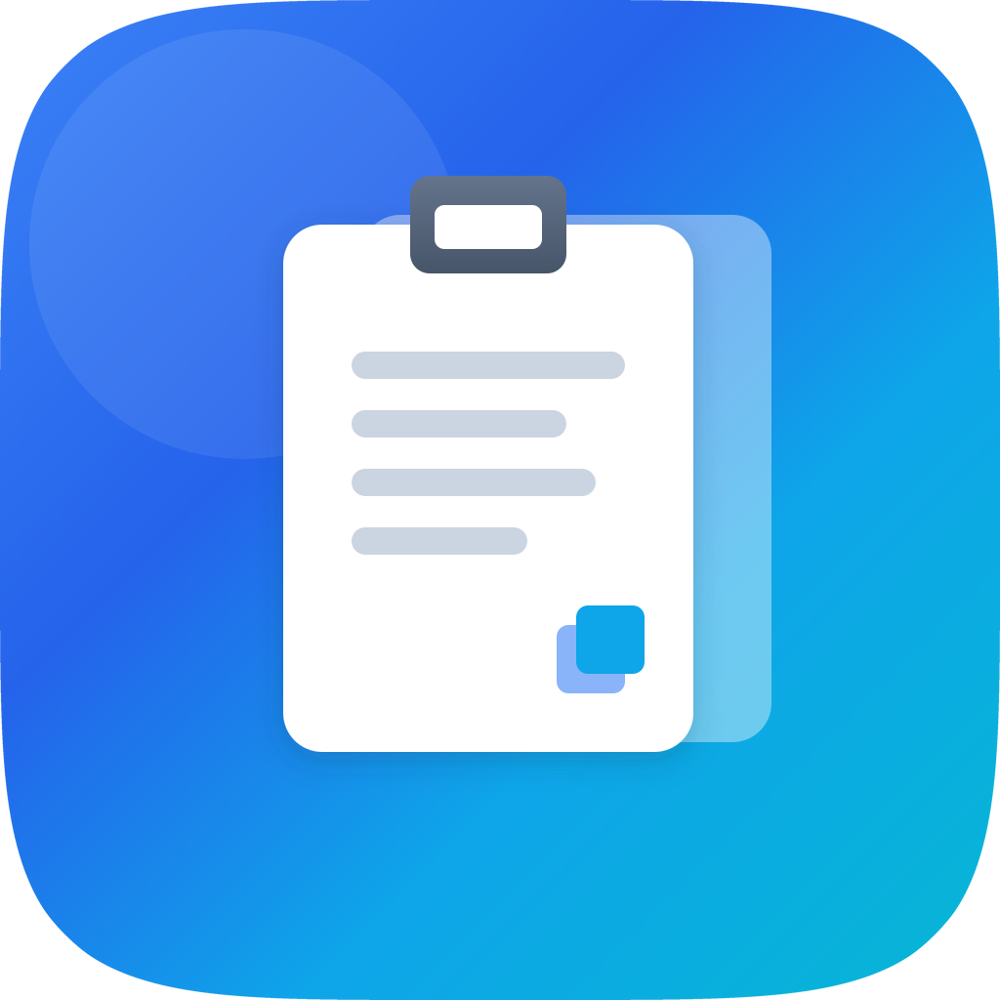
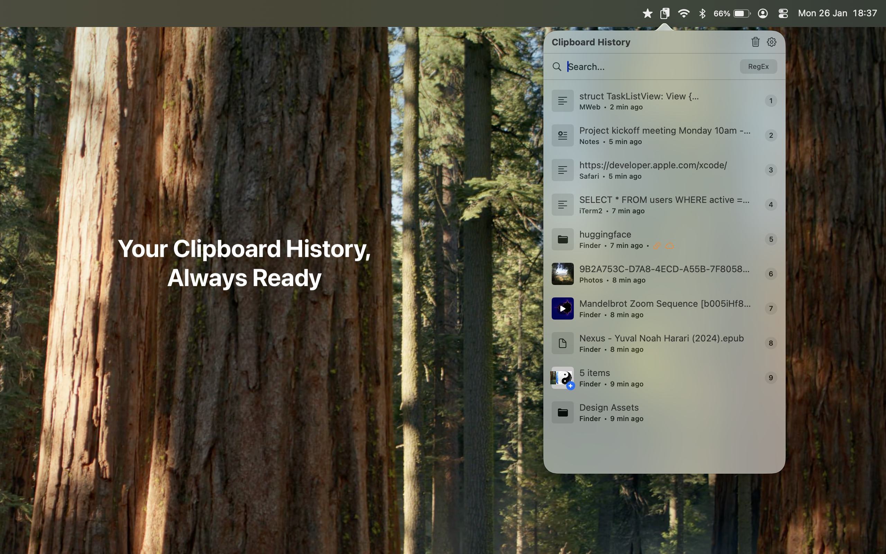
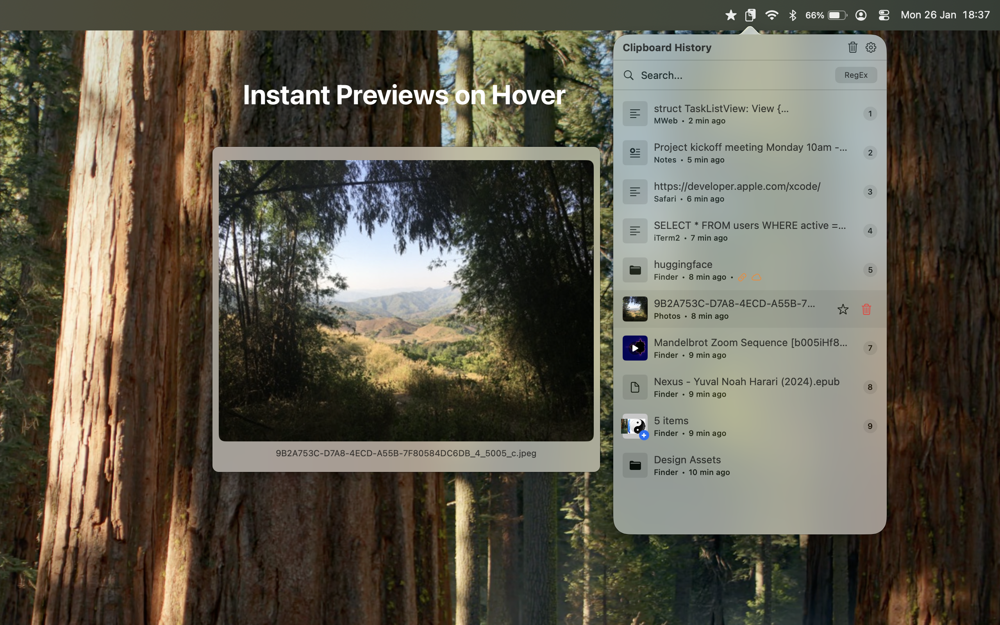
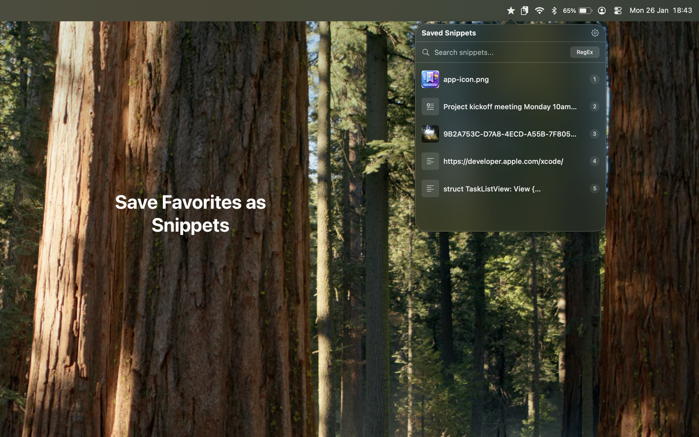

<p align="center">
  
</p>

<h1 align="center">ClipboardMenu</h1>

<p align="center">
  A clipboard history app with wide support — copy and save anything from text to videos.<br>
  Lightweight, native, and fully local. Lives in your Mac's menu bar.
</p>

<p align="center">
  <a href="https://apps.apple.com/app/clipboardmenu/id6757977297">Mac App Store</a> ·
  <a href="https://n14395.com/clipboardmenu">Website</a>
</p>



## What it does

ClipboardMenu monitors your clipboard in the background and automatically saves everything you copy. Click the menu bar icon — or press a global shortcut from any app — to search your full history and paste anything back with a single click. Star the items you reuse constantly and they become snippets that never expire.

## Features

- **Clipboard history for everything** — plain text, rich text (RTF), images, videos, single files, folders, and multi-file "stacks", with the source app and timestamp recorded for each item
- **Reusable snippets** — star any history item to keep it forever; snippets are exempt from cleanup, stored separately, and can be drag-reordered
- **Instant search** — case-insensitive filtering as you type, with a regex mode for power users; press Enter to paste the first result
- **Hover previews** — full-size image previews, auto-playing muted video loops, scrollable text/code previews, and file-stack listings in a floating window
- **Global shortcuts** — ⌘⇧V for history and ⌘⇧S for snippets by default, fully configurable
- **Smart deduplication** — copying something you've copied before moves the existing item to the top instead of creating a duplicate
- **Compact mode** — a denser single-line layout that fits more items on screen
- **Flexible storage** — configurable history size (10–1000 items), storage cap (100 MB–20 GB), and per-item size limit; large files are stored as references instead of copies

| Hover previews | Snippets menu |
|---|---|
|  |  |

## Privacy

Fully sandboxed with no network access — your clipboard never leaves your Mac.

- All data lives locally in `~/Library/Application Support/ClipboardMenu/` (a SQLite database plus media and thumbnail folders)
- No cloud sync, no uploads, no analytics, no telemetry
- Accessibility permission is optional and only used for the global keyboard shortcuts

## Requirements

- macOS 14.6 (Sonoma) or later
- Apple Silicon or Intel

## Install

```sh
brew tap n14395/tap
brew install --cask clipboard-menu
```

Or download the `.dmg` from [Releases](../../releases) and drag ClipboardMenu to Applications.

## Building from source

Requires a full Xcode install (not just the Command Line Tools — the SwiftUI macro plugins need Xcode's toolchain).

```bash
./build.sh            # production build → build/ClipboardMenu.app
./build.sh --dmg      # …plus a drag-to-install build/ClipboardMenu.dmg
./build.sh --help     # signing, notarization and release flags
```

Or open `ClipboardMenu.xcodeproj` in Xcode and run the `ClipboardMenu` scheme.

Built with Swift 6, SwiftUI + AppKit, [GRDB.swift](https://github.com/groue/GRDB.swift) for SQLite, and AVFoundation for video handling.

---

*ClipboardMenu — your clipboard, organized.*

## License

Licensed under the [Apache License, Version 2.0](LICENSE).
Third-party attribution is in [NOTICE](NOTICE).
